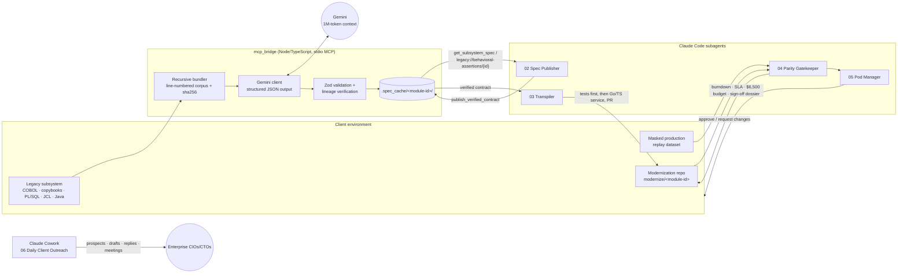

# LegacyModern AI — Operational Repository

Autonomous legacy monolith de-risking and cloud-native re-platforming, run by Claude Code,
Claude Cowork, and a Gemini long-context ingest bridge.

**Business model:** a $50,000, 14-day Proof-of-Value pilot that converts into a $100,000/month,
12-month retainer with a dedicated delivery pod. Ten retainers = **$1,000,000 MRR**.

**Delivery promise:** every modernized module ships only at **100% behavioral parity** with the
legacy code, proven by executable characterization tests traced to legacy source lines and by
replaying masked production history.

---

## 1. Architecture



| Component | Path | Role |
|---|---|---|
| Steering rules | `CLAUDE.md` | Test-Driven Characterization Rule, Zero-Regression Invariant, lineage, branching, verification commands |
| MCP spec bridge | `mcp_bridge/` | MCP server (stdio) exposing `ingest_legacy_subsystem`, `get_subsystem_spec`, `list_ingested_modules`, `publish_verified_contract`, and resource `legacy://behavioral-assertions/{moduleId}` |
| Gemini ingest client | `mcp_bridge/src/gemini_client.ts` | Bundles sources, prompts Gemini with structured JSON output, validates, repairs once, caches |
| Type system | `mcp_bridge/src/types.ts` | `LegacyModuleAnalysis`, `BehavioralAssertion`, `BehavioralContract`, `ModernizationWorkOrder` (TypeScript + Zod) |
| Agent prompts | `agents/` | 01 (Gemini system instruction) and 02–06 (Claude Code subagents, auto-loaded via `.claude/agents/`) |
| Contract schema | `templates/behavioral_contract.json` | JSON Schema 2020-12 with a complete worked example (LNFEE010, 31 assertions, each confirmed against the real COBOL under GnuCOBOL) |
| Parity harness | `templates/characterization_test.go` | Table-driven Go harness: exact-decimal comparison, tolerance + scale, rtrim, undeclared-state detection, parity report |
| Service template | `templates/target_service_boilerplate/` | Clean Architecture Go 1.22 service: domain invariants, use cases, router, `log/slog` JSON logs, `/healthz` + `/ready`, graceful shutdown |
| Sample legacy module | `examples/legacy/LNFEE010/` | COBOL program + copybook used by the demo and harness self-tests |
| Pod config | `config/pod_config.yaml` | Pods, sprint cadence, SLAs, token allocation and the $6,500/pod/month ceiling, model rates |
| MCP client config | `config/mcp_settings.json` (also `.mcp.json`) | Connects Claude Code to the spec bridge (and Gemini through it) and to GitHub |
| Outreach config | `config/outreach_schedule.yaml` | ICP, cadence, caps, compliance for the daily outreach agent |
| Commercial | `sales_and_commercial/` | Pilot SOW ($50k), retainer MSA ($100k/mo), outbound playbook |

---

## 2. Prerequisites

| Tool | Version | Used for |
|---|---|---|
| Node.js | ≥ 20.11 (22 LTS recommended) | MCP bridge |
| Go | ≥ 1.22 | Harness and service template |
| Claude Code | current | Agents 02–05, local build loops |
| Claude desktop app with Cowork | current | Agent 06 daily outreach |
| Gemini API key | — | `GEMINI_API_KEY` for ingest (Google AI Studio or Google Cloud) |
| GitHub personal access token | fine-grained, repo scope | `GITHUB_PERSONAL_ACCESS_TOKEN` for PR tools |
| Optional: `staticcheck`, `govulncheck`, `gosec`, `gitleaks` | latest | Gatekeeper checks |

Install Go tools:

```bash
go install honnef.co/go/tools/cmd/staticcheck@latest
go install golang.org/x/vuln/cmd/govulncheck@latest
```

---

## 3. Local setup

```bash
git clone <this repository> modernize-ai-agency
cd modernize-ai-agency

# Build and test the MCP bridge
(cd mcp_bridge && npm ci && npm run build && npm test)

# Run the parity harness and the service template tests
make verify
```

`make verify` runs every check from `CLAUDE.md` §6 for this repository: bridge typecheck and
tests, `gofmt`/`go vet`/`go test -cover` for the harness, and `gofmt`/`go vet`/`go test -race
-cover` for the service template. Expected result: bridge 9/9 tests, harness 31/31 parity
assertions, service ≥ 90% coverage.

Export credentials (use your secret manager or a shell profile that is not committed):

```bash
mkdir -p ~/.config/legacymodern && chmod 700 ~/.config/legacymodern   # store keys here, never in the repo
export GEMINI_API_KEY="$(cat ~/.config/legacymodern/gemini_api_key)"                  # required for ingest
export GITHUB_PERSONAL_ACCESS_TOKEN="$(cat ~/.config/legacymodern/github_token)"      # required for PR tools
export GEMINI_MODEL=gemini-3.1-pro-preview      # optional; default. Free-tier keys: gemini-3-flash-preview
export LEGACYMODERN_HOME="$PWD"                 # optional; defaults to the current directory
```

> **Model note (verified live on 2026-10-13).** Google has retired the 1.5 and 2.5 families
> for new keys (`gemini-2.5-pro` returns 404 "no longer available to new users"), so the bridge
> defaults to `gemini-3.1-pro-preview`. Pro models need a **billing-enabled** key — the free
> tier has zero Pro quota (429 "limit: 0"). For evaluation on a free-tier key, set
> `GEMINI_MODEL=gemini-3-flash-preview`: it ingested LNFEE010 in 76 s (15,884 tokens) and all
> 9 extracted assertions matched the compiled COBOL. Any long-context Gemini model works via
> `GEMINI_MODEL`; nothing else changes.

---

## 4. MCP server configuration

### Claude Code (automatic)
`.mcp.json` at the repository root is a symlink to `config/mcp_settings.json`, so starting
Claude Code in this directory offers to enable two project servers:

- `legacymodern-spec-bridge` — `node ./mcp_bridge/dist/index.js` (stdio), with the Gemini
  settings passed as environment variables;
- `github` — the GitHub remote MCP server, authenticated with your token.

```bash
cd modernize-ai-agency
claude                      # approve the project MCP servers when prompted
/mcp                        # inside Claude Code: both servers should show "connected"
```

Manual alternatives:

```bash
claude --mcp-config config/mcp_settings.json
# or register only the bridge for your user:
claude mcp add legacymodern-spec-bridge --scope user \
  -e GEMINI_API_KEY="$GEMINI_API_KEY" -e SPEC_CACHE_DIR="$PWD/.spec_cache" \
  -e INGEST_PROMPT_PATH="$PWD/agents/01_gemini_cognitive_ingest.md" \
  -- node "$PWD/mcp_bridge/dist/index.js"
```

### Subagents
`.claude/agents/` contains symlinks to `agents/02`–`06`, so `/agents` in Claude Code lists:
`mcp-spec-publisher`, `claude-code-transpiler`, `automated-parity-gatekeeper`,
`delivery-pod-manager`, `daily-client-outreach`. `agents/01_gemini_cognitive_ingest.md` is not
a Claude subagent; the bridge sends it to Gemini as the system instruction.

### Inspecting the bridge
```bash
cd mcp_bridge && npm run inspect      # opens the MCP Inspector against dist/index.js
```

### Bridge environment variables

| Variable | Default | Meaning |
|---|---|---|
| `GEMINI_API_KEY` / `GOOGLE_API_KEY` | — | Gemini credential (ingest only; read tools work without it) |
| `GEMINI_MODEL` | `gemini-3.1-pro-preview` | Model used for ingest (free-tier keys: `gemini-3-flash-preview`) |
| `GEMINI_MAX_INPUT_TOKENS` | `900000` | Refuse bundles larger than this (split the module) |
| `GEMINI_MAX_ATTEMPTS` | `2` | Initial call + validation-repair attempts |
| `SPEC_CACHE_DIR` | `./.spec_cache` | Where verified specs are stored |
| `INGEST_PROMPT_PATH` | `agents/01_gemini_cognitive_ingest.md` | Gemini system instruction |
| `MIN_RULE_CONFIDENCE` | `0.8` | Rules below this become review flags that block publication |
| `WORK_ORDER_SLA_HOURS` | `72` | SLA written into generated work orders |
| `MAX_BUNDLE_BYTES` / `MAX_FILE_BYTES` | `3500000` / `1500000` | Bundle limits |

---

## 5. End-to-end execution guide (LNFEE010 walkthrough)

The sample module `examples/legacy/LNFEE010` assesses late fees on loan accounts: 5% of the
balance, rounded half-up, capped at 25.00 after a 15-day grace period, with delinquency status
escalation and ordered validation. Run the full pipeline on it before using a client module.

### Step 1 — Ingest (Gemini through MCP)
In Claude Code, from the repository root:

```
Use the legacymodern-spec-bridge ingest_legacy_subsystem tool with
moduleId=LNFEE010, rootDir=examples/legacy/LNFEE010, repository=examples/legacy/LNFEE010,
commitSha=<git rev-parse HEAD>, clientAccount=DEMO, podId=pod-alpha,
targetLanguage=Go, targetServiceName=late-fee-service. Then show the summary.
```

The bridge bundles the two files with line numbers, calls Gemini with the ingest system prompt
and a JSON response schema, validates the result (schema, lineage ranges, rule/assertion cross
references), stores it under `.spec_cache/LNFEE010/`, and returns counts, review flags, and a
work order (`WO-2026-xxxxxx`, branch `modernize/LNFEE010`, due in 72 h).

### Step 2 — Verify and publish the contract
```
Use the mcp-spec-publisher subagent to audit and publish module LNFEE010.
```
The publisher spot-checks lineage against the COBOL, builds the coverage matrix, adds missing
boundary/ordering assertions, resolves review flags, dry-runs the harness in `SPEC_ONLY=1`
mode, and calls `publish_verified_contract`. Compare the result with the reference contract
in `templates/behavioral_contract.json` (`examples[0]`, version 1.2.0, 31 assertions).

### Step 3 — Characterize and transpile
Point the transpiler at a client modernization repo (for the demo, a scratch repo):

```
Use the claude-code-transpiler subagent on work order <WO id> for LNFEE010.
Target repo: ~/work/demo-modernization (default branch main). Budget: $300.
```
It creates `modernize/LNFEE010`, scaffolds from `templates/target_service_boilerplate`, pins
`contracts/LNFEE010.json`, commits the characterization suite red (`Parity: 0/31 (red)`),
implements until green, runs the full verification loop, writes `LINEAGE.md`, and opens a PR.
The template already contains a reference implementation of LNFEE010, so for the demo this
step is mostly verification; for a client module it is the main build.

### Step 4 — Parity gate
```
Use the automated-parity-gatekeeper subagent on PR <url>.
Replay dataset: <path with manifest.json>.
```
It runs gates G1–G12 (contract pinning, test-first history, static checks, race detector,
contract parity, dual-engine replay, branch coverage ≥ 90%, lineage, latency, security,
hygiene) and approves or requests changes with an evidence report.

### Step 5 — Pod operations
```
Use the delivery-pod-manager subagent to post today's standup for pod-alpha.
```
It refreshes work-order state, burndown, SLA clocks and month-to-date model spend against the
$6,500 ceiling, applies threshold actions, and on day 12–13 drafts the milestone sign-off
dossier that triggers acceptance and invoicing.

### Running the harness against any contract
```bash
cd templates
BEHAVIORAL_CONTRACT=/path/to/contract.json PARITY_REPORT_PATH=parity.json go test -v ./...
REQUIRE_VERIFIED_CONTRACT=1 go test ./...                      # CI mode
SPEC_ONLY=1 go test -run TestContractIntegrity ./...           # audit before an adapter exists
```

### Running the service template
```bash
cd templates/target_service_boilerplate
go run .                                    # listens on :8080
curl -s localhost:8080/ready
curl -s -X POST localhost:8080/v1/late-fees/quote -H 'Content-Type: application/json' \
  -d '{"outstandingBalance":"100.10","daysPastDue":30,"accountStatus":"CURRENT"}'
# {"lateFee":"5.01","feeAssessed":true,"previousStatus":"CURRENT","newStatus":"DELINQUENT"}
```
Endpoints: `GET /healthz`, `GET /ready`, `POST /v1/late-fees/quote`,
`PUT /v1/accounts/{accountId}`, `GET /v1/accounts/{accountId}`,
`POST /v1/accounts/{accountId}/late-fees`. `SIGTERM` flips `/ready` to 503, waits
`READINESS_DRAIN_DELAY` (5 s), then drains in-flight requests within `SHUTDOWN_TIMEOUT` (20 s).

---

## 6. Daily client outreach with Claude Cowork

Agent 06 reaches prospects every business morning: it handles replies first, drafts due
follow-ups, finds up to 15 new ICP prospects with a verifiable trigger each, drafts
personalized first touches from `sales_and_commercial/cto_outbound_pitch.md`, books meetings,
updates the tracker, and emails a daily report.

**Setup (once):**
1. In the Claude desktop app, open **Cowork** and give it access to this repository folder.
2. Connect **Gmail** (or Google Workspace mail) and **Google Calendar**; enable a prospecting
   connector if you have one (e.g. Vibe Prospecting or Apollo). Enabling the **Sales** plugin
   adds outreach and call-prep skills the agent can use.
3. Set sender details as environment variables or in the Cowork task instructions:
   `OUTREACH_SENDER_NAME`, `OUTREACH_SENDER_TITLE`, `OUTREACH_SENDER_PHONE`,
   `OUTREACH_CALENDAR_LINK`, `OUTREACH_POSTAL_ADDRESS` (legally required in commercial email),
   `OUTREACH_REPORT_RECIPIENTS`.
4. Review `config/outreach_schedule.yaml`: ICP, daily caps, time zone, and keep
   `mode: draft_for_approval` for at least the first two weeks.

**Schedule it:** create a Cowork scheduled task for every weekday at 08:20 with this prompt:

```
Run the daily client outreach for LegacyModern AI. Follow agents/06_daily_client_outreach.md
exactly, using config/outreach_schedule.yaml and sales_and_commercial/cto_outbound_pitch.md.
Draft only (mode draft_for_approval). Finish with the daily report.
```

Cowork's local scheduled tasks run while your computer is awake and the desktop app is open.
For unattended runs, create the same prompt as a **Claude Code routine** on a cloud
environment that has the Gmail and Calendar connectors attached.

Each morning, review the Gmail label `LegacyModern/Outreach/<date>`, edit if needed, and send.
Prospect data lives in `outreach_data/` (git-ignored) because it contains personal data.

---

## 7. Operating cadence

| When | Who | What |
|---|---|---|
| Every business day 08:20 | Agent 06 (Cowork) | Outreach run + report |
| Every business day 09:00 | Agent 05 | Pod standup: burndown, SLA, spend |
| On every PR marked ready | Agent 04 | Parity gate |
| Sprint day 1 | Pod lead + Agent 05 | Planning (≤ 3 concurrent work orders) |
| Sprint days 5 and 10 | Pod lead | Client status call |
| Sprint day 7 | Agent 05 | Mid-sprint budget review |
| Sprint day 12–13 | Agent 05 + pod lead | Sign-off dossier and client review |
| Weekly | Agent 05 | Token spend reconciliation against invoices |
| Monthly | Delivery director | Steering committee per account |

---

## 8. Verification

```bash
make verify            # everything below
make bridge            # cd mcp_bridge && npm ci && npm run typecheck && npm test
make harness           # cd templates && gofmt check && go vet && go test -v -cover
make service           # cd templates/target_service_boilerplate && gofmt check && go vet && go test -race -cover
```

CI (`.github/workflows/ci.yml`) runs the same targets on every push and pull request.

---

## 9. Security and compliance

- Secrets come from the environment; `.gitignore` excludes `.spec_cache/`, `outreach_data/`,
  build output, and coverage/parity artifacts.
- Production data never leaves client environments; only masked replay datasets with a
  masking attestation are used.
- AI usage is disclosed per model in the MSA (Exhibit E); commercial API terms with no training
  on client content are required.
- Outreach follows CAN-SPAM, PECR/GDPR legitimate-interest, and CASL rules encoded in
  `config/outreach_schedule.yaml`; the agent drafts by default and never contacts suppressed
  addresses.
- The SOW and MSA are commercial templates; have counsel review each executed copy.

---

## 10. Troubleshooting

| Symptom | Fix |
|---|---|
| `/mcp` shows the bridge as failed | Run `npm run build` in `mcp_bridge/`; confirm `node --version` ≥ 20.11; start Claude Code from the repository root (paths in `.mcp.json` are relative). |
| `GEMINI_API_KEY ... is not set` | Export the key before starting Claude Code; read-only tools still work without it. |
| `Subsystem renders to N tokens` | The module is too large for one pass; split along CALL/package boundaries and ingest parts separately. |
| `Gemini model "..." is not available to this API key (404)` | The model is retired for new keys; list models for your key (`curl -H "x-goog-api-key: $GEMINI_API_KEY" https://generativelanguage.googleapis.com/v1beta/models`) and set `GEMINI_MODEL`. |
| `Gemini quota exhausted` | Free-tier keys have no Pro quota: enable billing on the key's Google Cloud project, or use `gemini-3-flash-preview` for evaluation. The bridge fails fast instead of retrying a quota that resets in hours. |
| `503 ... experiencing high demand` | Transient provider overload; the bridge retries 4 times with backoff (about 30 s). Re-run later or pick another model. |
| Ingest tool call times out in Claude Code | A live ingest takes 20–90 s for a small module and longer for large ones; raise Claude Code's MCP tool timeout (`MCP_TOOL_TIMEOUT`, milliseconds) if your client cuts it off. |
| `failed validation after 2 attempt(s)` | Read `details.issues`; usually missing copybooks (add them) or lineage outside file ranges; re-run with `forceRefresh: true`. |
| `Contract not published: review flags are unresolved` | Provide a `resolutions` entry for each flag, copied verbatim. |
| Parity test fails on a decimal | Check for `float64`; compare scale; the harness rejects extra decimal places by design. |
| Coverage below 90% | Add tests for error paths and transport validation; do not exclude files to raise the number. |
| Outreach agent produced no drafts | Sender env vars (especially postal address) are missing — the agent runs research-only by design. |
