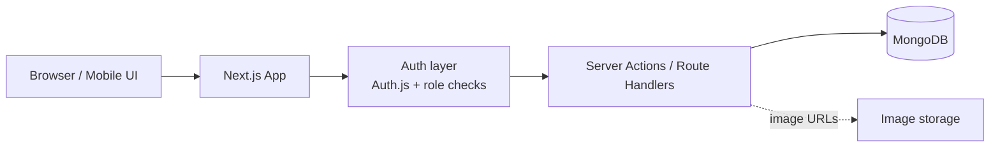
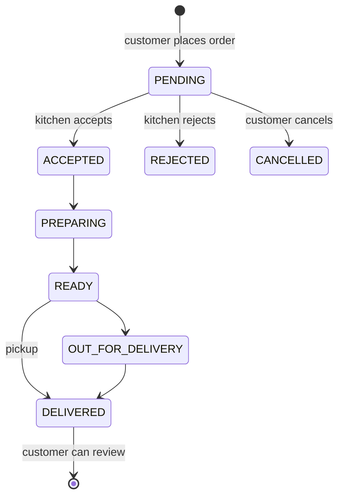
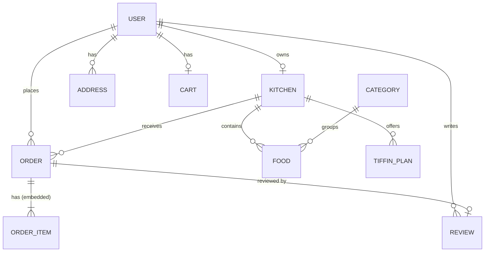

# 🍛 Mom's Kitchen — Home Food & Tiffin Marketplace

A full-stack **Next.js** web app that connects local home cooks and small tiffin providers with customers who want fresh, homemade food. Built from the *Mom's Kitchen — Complete Project Planning & Development Document*.

It works on **phones, tablets and desktops**. There are three roles:

| Role | What they can do |
| --- | --- |
| **Customer** | Browse kitchens by cuisine, city or pincode · view menus & tiffin plans · cart · checkout (cash on delivery) · track orders live · cancel pending orders · review delivered orders · manage addresses & profile |
| **Home Cook** (provider) | Create a kitchen profile · add/edit/delete dishes and daily/weekly/monthly tiffin plans · mark items sold out · open/close the kitchen · accept/reject orders and update their status · see earnings and reviews |
| **Admin** | Dashboard with platform stats · approve/reject/suspend kitchens · block/unblock users · manage categories · moderate food listings and reviews · view and manage all orders |

---

## 🚀 Run it in VS Code

### 1. Install these once

- **Node.js 20 LTS** (or newer) — <https://nodejs.org>
- **VS Code** — <https://code.visualstudio.com>

### 2. Open the project

1. In VS Code choose **File → Open Folder…** and select the **`moms-kitchen`** folder.
   (Or from a terminal: `code moms-kitchen`)
2. When VS Code asks *"Do you want to install the recommended extensions?"* click **Install** (ESLint, Tailwind CSS IntelliSense, MongoDB).
3. Open the terminal with **Ctrl + `** (backtick) and install the packages:

   ```bash
   npm install
   ```

4. Create your settings file by copying the example:

   ```bash
   # Windows (Command Prompt / PowerShell)
   copy .env.example .env.local

   # macOS / Linux
   cp .env.example .env.local
   ```

   The defaults work for local development. (You can skip this step entirely in development — the app falls back to a local database and a development-only secret.)

### 3. Start the database

Pick **one** option:

| Option | When to use | What to do |
| --- | --- | --- |
| **A. `npm run db`** (easiest) | You don't have MongoDB installed | Run `npm run db` in a terminal and **leave it open**. The first start downloads MongoDB (~100 MB). Data is saved in the `.mongo-data` folder. |
| **B. MongoDB Community Server** | You already installed MongoDB on your computer | Nothing to do — it runs at `mongodb://127.0.0.1:27017` which is the default. |
| **C. MongoDB Atlas** (cloud, free) | You want an online database / plan to deploy | Create a free cluster at <https://www.mongodb.com/atlas>, then put its connection string in `.env.local` as `MONGODB_URI=…/moms-kitchen` |

### 4. Start the website

Open a **second** terminal (click **+** in the terminal panel) and run:

```bash
npm run dev
```

Open **<http://localhost:3000>** in your browser. 🎉

The first time the app connects to an empty database it **automatically adds sample kitchens, dishes, orders, reviews and demo accounts**.

> **One-click start:** press **Ctrl + Shift + B** (or *Terminal → Run Task… → Start Mom's Kitchen*) to start the database and the website together.

### 5. Log in with a demo account

The login page has buttons that fill these in for you.

| Role | Email | Password |
| --- | --- | --- |
| Customer | `customer@momskitchen.com` | `customer123` |
| Home Cook | `meena@momskitchen.com` | `provider123` |
| Admin | `admin@momskitchen.com` | `admin123` |

Other sample home cooks (`harpreet@`, `asha@`, `lakshmi@`, `rekha@`, `sunita@momskitchen.com`) also use `provider123`. *Annapurna Tiffin Service* (sunita@) is waiting for admin approval so you can try the approval flow.

### 📱 Open it on your phone

Keep `npm run dev` running and connect your phone to the **same Wi-Fi** as your computer. The terminal prints a **Network** address such as `http://192.168.1.5:3000` — open that on your phone. (On Windows, click **Allow** if the firewall asks about Node.js.)

---

## 🧰 Useful commands

| Command | What it does |
| --- | --- |
| `npm run dev` | Start the development server at http://localhost:3000 |
| `npm run db` | Start a local MongoDB without installing it (keep it running) |
| `npm run seed` | **Reset** the database and insert the sample data again |
| `npm test` | Run unit tests for the cart, order-status and review rules |
| `npm run typecheck` | Check TypeScript types |
| `npm run lint` | Run ESLint |
| `npm run build` then `npm start` | Production build and server (needs `MONGODB_URI` and `AUTH_SECRET` in `.env.local` — the development fallbacks are switched off in production) |

VS Code tasks (*Terminal → Run Task…*) and debug configurations (*Run and Debug* panel) are included in `.vscode/`.

---

## 🏗️ Technology stack

| Layer | Technology (as in the report) |
| --- | --- |
| Frontend | Next.js 15 (App Router) + React 19 + TypeScript |
| Styling | Tailwind CSS — mobile-first responsive design |
| Backend | Next.js Server Actions + Route Handlers |
| Database | MongoDB with **Mongoose** |
| Authentication | **Auth.js** (NextAuth v5) — email & password, bcrypt-hashed, JWT sessions, role-based access |
| Validation | Zod schemas on every form / server action |
| Images | Image URL fields (Cloudinary upload can be added later); colourful emoji illustrations are shown when there is no photo |
| Payments | Cash / UPI on delivery (Razorpay is listed as a future feature) |
| Deployment | Vercel + MongoDB Atlas |

---

## 📂 Project structure

```
moms-kitchen/
├── app/                        # Pages (Next.js App Router)
│   ├── page.tsx                # Home: hero + search, categories, popular kitchens & food, how it works
│   ├── about/  how-it-works/   # Information pages
│   ├── (auth)/login  register  # Authentication
│   ├── kitchens/  kitchens/[id]  food/[id]   # Discovery
│   ├── checkout/               # Address, notes, payment, place order
│   ├── customer/               # dashboard, orders, orders/[id], cart, addresses
│   ├── provider/               # dashboard, orders, menu, tiffin, kitchen, reviews
│   ├── admin/                  # dashboard, providers, orders, users, listings, categories, reviews
│   ├── profile/                # Profile + change password (all roles)
│   └── api/auth/[...nextauth]/ # Auth.js route handler
├── components/                 # Reusable UI (navbar, cards, forms, status timeline, …)
├── lib/
│   ├── models/                 # Mongoose models (User, Kitchen, Food, Category, TiffinPlan, Address, Cart, Order, Review)
│   ├── actions/                # Server actions (all writes; each checks the user's role)
│   ├── data/                   # Read queries for pages
│   ├── order-rules.ts          # Business rules: status transitions, totals, review eligibility
│   ├── validations.ts          # Zod schemas
│   ├── db.ts  seed.ts          # Database connection + sample data
│   └── session.ts              # getCurrentUser / requireUser(role)
├── auth.ts  auth.config.ts     # Auth.js setup
├── middleware.ts               # Redirects for protected areas
├── scripts/                    # seed.ts, local-db.mjs
├── tests/                      # Unit tests (node:test)
└── .vscode/                    # Recommended extensions, tasks, debug configs
```

---

## 🧭 Architecture



1. The browser talks to the Next.js app (server-rendered pages).
2. `middleware.ts` redirects visitors away from areas their role can't access.
3. Every page and server action **re-checks the logged-in user against the database** (`requireUser([...roles])`), so blocked users and role changes take effect immediately.
4. Server actions validate input with Zod, apply the business rules and write to MongoDB.

### Order lifecycle



Admins can also cancel any active order. The rules live in `lib/order-rules.ts` and are unit-tested.

### Database (ER concept)



Order items are embedded inside each order and keep a **snapshot of the name and price** at purchase time. The delivery address is snapshotted too, so later edits never change old orders.

---

## ✅ Business rules & security (from the report)

- Only **approved** kitchens (and their food) are visible to the public; owners and admins can preview pending ones.
- A provider can only edit **their own** kitchen, menu, tiffin plans and orders (checked on the server for every action).
- Items can be ordered only when the dish/plan is available and the kitchen is open; a cart holds items from **one kitchen**.
- **Cart totals are calculated on the server** from database prices — prices sent by the browser are never trusted.
- Customers can only see **their own** orders and addresses.
- Reviews are allowed **once per order, only after delivery**; admins can hide or delete reviews (ratings are recalculated).
- Passwords are hashed with **bcrypt**; blocked users cannot log in.
- Every form is validated with **Zod**; error messages don't leak server details.
- Secrets stay in `.env.local` (git-ignored). Regex searches escape user input.

---

## 🧪 Testing

- `npm test` — unit tests for cart totals, delivery fee, order status transitions per role, review eligibility and order numbers.
- Manual test plan (matches section 26 of the report):

| Area | Try this |
| --- | --- |
| Authentication | Log in with each demo account; wrong password; visit `/admin/dashboard` as a customer (you get redirected) |
| Kitchen | Register a new home cook → create kitchen → log in as admin → approve it → it appears on `/kitchens` |
| Food | Add, edit, mark sold out and delete dishes from **Provider → Menu** |
| Cart | Add items, change quantities, try adding from a second kitchen (you'll be asked to replace the cart) |
| Orders | Place an order as the customer → accept and move it to *Delivered* as `meena@` → watch the timeline update |
| Reviews | Review the delivered order; try again (not allowed) |
| Admin | Block a user, add a category, hide a review |
| Responsive UI | Resize the browser or open on a phone/tablet |

---

## ☁️ Deploying (Vercel + MongoDB Atlas)

1. Push the code to GitHub and import the repository on <https://vercel.com>. Set the **Root Directory** to `moms-kitchen`.
2. Add environment variables in Vercel: `MONGODB_URI` (Atlas connection string) and `AUTH_SECRET` (generate with `npx auth secret`).
3. In Atlas → *Network Access*, allow connections from Vercel (e.g. `0.0.0.0/0` for a demo).
4. Deploy. The sample data is inserted on the first visit (set `AUTO_SEED=false` to disable).

---

## 🛠️ Troubleshooting

| Problem | Fix |
| --- | --- |
| *"We couldn't connect to the database"* | Start MongoDB (`npm run db` in another terminal) or check `MONGODB_URI` in `.env.local`. |
| `npm run db` says the port is busy | MongoDB is already running — just run `npm run dev`. |
| `npm run db` can't download MongoDB | Check your internet connection, or use option B/C above. |
| Port 3000 is in use | Run `npm run dev -- -p 3001` and open http://localhost:3001. |
| Want fresh demo data | `npm run seed` (this deletes all data first). |
| `npm run build` warns *"A Node.js API is used (CompressionStream…)"* | Harmless — it comes from the `jose` library inside Auth.js and does not affect the app. |
| `npm start` shows *MissingSecret* or *MONGODB_URI is not set* | Create `.env.local` (step 2.4) — production mode requires both values. |
| Logged in but pages redirect to login after a reset | Log out and log in again (old session after `npm run seed`). |

---

## 🔮 Future features (from the report)

Razorpay online payments · WhatsApp/email notifications · real-time order status · map-based service areas · delivery partner module · tiffin subscriptions with pause/skip dates · offers/coupons · provider earnings analytics · customer favourites · AI-based food recommendations.
